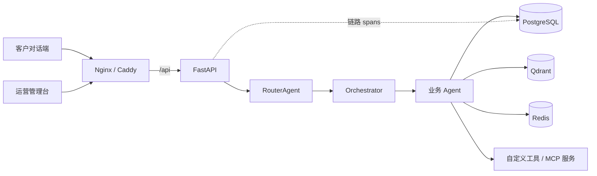

# AgentDock

[](https://github.com/ccOranger/smart-cs/actions/workflows/ci.yml)

> **可私有化部署的对话式 Agent 运营平台。** 把多意图路由、知识库、工具调用、跨轮记忆和全链路追踪装进一个管理台；客服/售后是首个场景包，不是产品边界。

仓库代号仍为 `smart-cs`：Compose 项目名、Python 包名与目录结构保持不变，产品对外名称统一为 **AgentDock**。

> 当前为 v0.1 早期版本，接口、表结构与场景包契约仍可能调整；升级前请先备份。

## 它解决什么问题

多数"智能客服"项目停在"文档问答 + 一个大模型提示词"：一条消息里有两个诉求只能答一个，追问下一句就忘了上文，工具调用看不见执行过程，出了问题也说不清是哪一步。

AgentDock 把这些做成平台能力，而不是某个业务里的临时代码：

| 能力 | 说明 | 关键开关 |
|---|---|---|
| **多意图路由** | 一条消息拆成多个意图，按主次串行应答；追问自动续接上一轮 Agent；"不贴合任何 Agent"时可先由兜底 Agent 应答 | `ROUTER_MAX_INTENTS` / `ROUTER_CONFIDENCE_THRESHOLD` / `ROUTER_FALLBACK_ANSWER` |
| **混合 Agent 注册** | 代码托管 Agent 与后台动态 Agent 同时注册；新增/停用实时进入路由候选，无需改路由代码 | 运营台「Agent 管理」 |
| **路由线索** | 每个 Agent 声明触发关键词与典型问法，路由提示词去具名化，不偏向任何内置 Agent | `routing_keywords` / `routing_examples` |
| **知识与 RAG** | 多命名空间、文档上传/分块浏览/重建索引/原文下载、检索测试；向量存 Qdrant | `RAG_*` / `RAG_DEFAULT_NAMESPACE` |
| **工具调用** | 代码自定义工具 + MCP（stdio / SSE / streamable HTTP），异步执行并记录结果 | 运营台「自定义工具」「MCP 服务」 |
| **跨轮记忆** | working / episodic / perceptual 三层开箱可用；semantic 需 Neo4j；工单可跨轮补录 | `MEMORY_*` / `MEMORY_TYPES` |
| **上下文工程** | 按系统提示、历史、记忆、知识分配 token 预算，超限按优先级裁剪 | `CONTEXT_*` |
| **全链路追踪** | 每轮对话的路由、LLM、工具、RAG、记忆调用都有 spans 与耗时；可采样、可设保留期 | `TRACE_*` |
| **固定话术** | 高频确定性问题在路由与大模型之前逐字命中，后台可测命中、可停用 | 运营台「固定话术」 |
| **双端身份** | 后台人员与客户分表、分登录入口、Token 隔离；客户可自助注册 | `/auth/staff/*`、`/auth/customer/*` |
| **运营台** | 咨询、工单、链路、知识库、Agent、路由分发器、MCP、工具、话术、记忆、仪表盘 | `http://<host>:8080/admin/` |

## 架构



一轮消息的处理顺序：

1. 固定话术命中则直接逐字下发（不进入路由，也不调用大模型）；
2. `RouterAgent` 输出按主次排序的意图数组，低置信主意图整轮转人工；
3. `Orchestrator` 串行调度各业务 Agent：上下文工程 → 记忆召回 → RAG 检索 → 工具调用 → 流式应答；
4. 每个环节写入 `request_traces.spans`，SSE 的 `done` 事件带上 `trace_id`，可在运营台直达本轮链路。

## 快速开始（Docker Compose）

前置：Docker Engine / Docker Desktop + Compose **v2.24.4+**，本机无需 Python / Node；建议 4 核 8 GB 以上（首次构建约 5–8 分钟）。

```bash
cp backend/.env.example .env      # Windows: copy backend\.env.example .env
```

编辑 `.env`，至少填写：

```ini
# 对话模型（OpenAI 兼容端点）
LLM_MODEL_ID=deepseek-chat
LLM_API_KEY=sk-xxx
LLM_BASE_URL=https://api.deepseek.com/v1

# 向量模型（记忆与 RAG）
EMBED_MODEL_TYPE=dashscope
EMBED_MODEL_NAME=text-embedding-v2
EMBED_API_KEY=sk-xxx
EMBED_BASE_URL=https://dashscope.aliyuncs.com/compatible-mode/v1

# 鉴权（必填，否则 Compose 拒绝启动）
JWT_SECRET=<openssl rand -base64 48 的输出>
```

```bash
docker compose up -d --build
docker compose ps                 # postgres / qdrant / redis / backend / web 均应为 healthy
```

| 入口 | 地址 |
|---|---|
| 客户对话端 | http://localhost:8080/ |
| 管理后台 | http://localhost:8080/admin/ |
| 后端调试（仅宿主机回环） | http://localhost:8000/docs |

首次启动会自动建表并写入种子数据。`SEED_DEMO=false`（默认）时只创建一个管理员，**随机密码在 backend 首次启动日志中打印一次**：

```bash
docker compose logs backend | grep -i "密码"     # Windows: docker compose logs backend | Select-String "密码"
```

也可以先在 `.env` 里用 `SEED_ADMIN_USERNAME` / `SEED_ADMIN_PASSWORD` 指定初始管理员。

验证三件事：后台能登录 → 客户问一句业务问题能看到流式回复 → 运营台「链路追踪」能看到这一轮的 spans。

> 只想本地演示？在首次 `docker compose up` 前把 `SEED_DEMO=true` 写入 `.env`。演示账号为 `admin / Admin@123`、`service01 / Agent@123`、`alice / Alice@123`，**切勿用于生产**。

更细的步骤与常见报错见 [快速开始](docs/quickstart.md)。

## 场景包

平台内核只认 manifest 的通用字段，业务资产放在 `backend/app/packs/<pack>/`：

```
backend/app/packs/customer_service/
  manifest.yaml     # name / display_name / version / enabled / agents / tools / knowledge.namespaces
  agents/           # 代码 Agent（继承 BaseBusinessAgent）
  prompts/          # 业务提示词
  tools/            # 领域工具（订单、物流、退款、工单）
  seeds/            # 演示数据与知识库文档
  ui/               # 场景文案
```

约束：内核不 import 包内模块，由 `packs/loader.py` 反向注册；包可以依赖平台能力，平台不依赖包。当前内置 `customer_service`，第二个场景包 IT Helpdesk 规划在 M4。

新增场景包的方式见 [领域解耦清单](docs/domain-decoupling.md)。

## 生产部署

单机生产在基础编排上叠加 `docker-compose.prod.yml`：

```bash
docker compose -f docker-compose.yml -f docker-compose.prod.yml up -d
```

它提供 Caddy 自动 HTTPS、固定数据目录（`DATA_ROOT`）、资源与日志限制、Redis/Qdrant 鉴权、一次性初始化（`INIT_ON_START=false`）。

```bash
COMPOSE="docker compose -f docker-compose.yml -f docker-compose.prod.yml"
$COMPOSE up -d --build postgres qdrant redis
$COMPOSE run --rm backend python ../scripts/init_db.py
$COMPOSE run --rm backend python ../scripts/seed_data.py
$COMPOSE up -d --build
```

备份（PostgreSQL + Qdrant 快照 + 业务数据 + Redis RDB，带保留期）：

```bash
COMPOSE_FILE="docker-compose.yml:docker-compose.prod.yml" bash scripts/backup.sh
```

完整的 HTTPS、升级、恢复与安全清单见 [部署指南](docs/deployment.md) 与 [运维手册](docs/runbook.md)。

## 本地开发

```bash
# 后端
cd backend
uv venv --python 3.12
uv pip install -r requirements-dev.txt --python .venv/Scripts/python.exe
cp .env.example .env             # 本地库/Redis/Qdrant 连接串
python ../scripts/seed_data.py   # 建表 + 种子（幂等）
.venv/Scripts/python.exe -m uvicorn app.main:app --host 0.0.0.0 --port 8000 --reload

# 前端（仓库根，npm workspaces）
npm ci
npm run dev:chat                 # http://localhost:5173
npm run dev:admin                # http://localhost:5174
```

请用 `localhost` 而不是 `127.0.0.1` 访问 Vite 开发服务器（可能只监听 IPv6）。开发环境、测试命令与提交规范见 [CONTRIBUTING.md](CONTRIBUTING.md)。

## 目录结构

```
backend/          FastAPI + HelloAgents（app/{api,core,agents,packs,tools,models,services}）
frontend/         客户对话端（Vue 3）
admin-frontend/   运营管理台（Vue 3）
packages/shared/  npm workspaces 共享包 @cs/shared（http / auth / SSE / 类型）
docker/           镜像、入口脚本、Nginx 与 Caddy 配置
scripts/          init_db / seed_data / rebuild_and_seed / backup / cleanup_traces
docs/             快速开始、配置、部署、FAQ、运维手册、规范与更新记录
```

## 文档

| 文档 | 内容 |
|---|---|
| [快速开始](docs/quickstart.md) | 从零到首次对话，含常见报错 |
| [配置说明](docs/configuration.md) | `.env` 全量配置、默认值与生效优先级 |
| [部署指南](docs/deployment.md) | Compose、生产叠加、HTTPS、备份恢复 |
| [常见问题](docs/faq.md) | 模型接入、Qdrant、MCP、Windows 编码、端口冲突 |
| [运维手册](docs/runbook.md) | 服务清单、排障、数据维护、安全 |
| [API 速查](docs/api.md) | 接口、SSE 事件与错误码 |
| [技术文章](docs/articles/01-multi-intent-routing.md) | 多意图路由与提示词去具名化 |
| [开发规范](docs/spec.md) | Spec v2.0，与实现同步 |
| [功能更新记录](docs/updates/README.md) | U01–U16 每项能力的落地细节 |

## 路线图

| 阶段 | 状态 | 内容 |
|---|---|---|
| M0–M2 | 已完成 | 工程基线、场景包解耦、前端单仓化、一键部署与初始化向导 |
| M3 | 进行中 | 命名、README、运维文档、演示物料、技术文章 |
| M4 | 计划中 | IT Helpdesk 场景包，验证"同一内核、不同场景" |
| M5 | 计划中 | v0.1 正式发布（Release Notes、镜像、社区） |
| 发布后 | 按反馈 | 聊天挂件化、RBAC/SSO、版本化迁移、评测与回归 |

## 明确不做（12 个月内）

- 通用 DAG 可视化编排与插件市场；
- 计费系统与自助订阅；
- 多租户 SaaS 隔离（当前单实例单租户，仅预留 `tenant_id`）；
- 移动端 App、自研模型/向量库/工单全流程；
- 为单个客户 fork 代码（只接受配置与场景包定制）。

## 贡献与安全

- [贡献指南](CONTRIBUTING.md)
- [安全策略](SECURITY.md)
- 场景包与领域边界见 [领域解耦清单](docs/domain-decoupling.md)，产品定位见 [定位文档](docs/positioning.md)

## 许可证

Apache License 2.0，详见 [LICENSE](LICENSE)。
