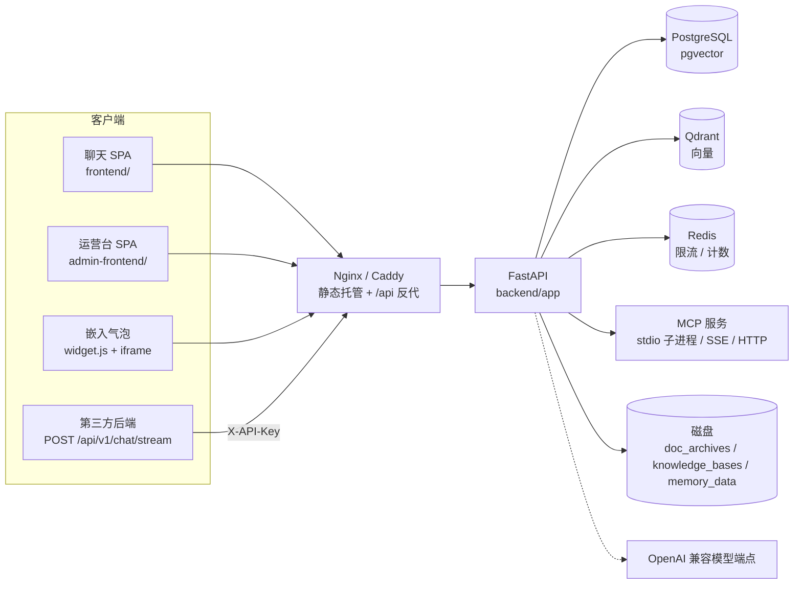

# 架构说明

> 面向要改代码、要做容量评估、或要排查线上问题的人。讲的是**当前实现**，不是设想；
> 每个小节都标了对应模块，读完可以按文件名进代码。
> 关联：[快速开始](./quickstart.md)、[配置说明](./configuration.md)、[API 速查](./api.md)、[多场景开发](./multi-scene-development.md)、[评测与回归](./evaluation.md)。

## 1. 组件拓扑



| 组件 | 职责 | 代码位置 |
|---|---|---|
| Nginx | 托管两个前端产物（`/`、`/admin/`）、反代 `/api`、SSE 关闭缓冲、上传 25m | `docker/nginx.conf` |
| FastAPI | 对外 REST + SSE；鉴权、限流、埋点、链路 | `backend/app/main.py`、`app/api/v1/*` |
| ChatService | 一轮对话的会话/消息/落库与 SSE 事件包装 | `app/services/chat_service.py` |
| Orchestrator | 固定话术 → 路由 → 逐意图执行 → 记忆归档 | `app/agents/orchestrator.py` |
| ContextEngineer | 记忆召回 + RAG 检索 + token 预算裁剪；轮后归档 | `app/core/context_engineer.py` |
| Agent 注册表 | 代码 Agent + DB 动态 Agent 统一解析 | `app/agents/registry.py` |
| 工具层 | 代码自定义工具目录 + MCP 加载器 | `app/tools/custom_catalog.py`、`app/tools/mcp_loader.py` |
| TraceCollector | 内存累加 span，流结束后一次性落库 | `app/core/tracing.py` |

## 2. 启动与关闭

启动顺序（`app/main.py` 的 `lifespan`）：

1. `assert_schema_version()`：库内 `schema_version` 与代码常量不一致即拒绝启动，提示跑迁移；
2. `run_startup_selfcheck()`：数据库 / Redis / Qdrant / 模型逐项检查，失败给一行可操作错误（不抛长堆栈）；
   其中**数据库与 Qdrant 不可用直接中止启动**（记忆/RAG 硬依赖），Redis 与模型只告警；
3. `init_hello_agents()`：建 `MemoryTool` / `RAGTool` / `LLM` 单例；
4. `validate_agents_sync()`：代码注册表与 DB `source=code` 行对齐（库里多余的只告警，代码新增的自动登记）；
5. `ensure_default_scene()`：默认场景被误删时按常量重建。

关闭顺序：`drain_background_tasks()`（最多 5s，等记忆归档写完）→ `close_redis()` → `bootstrap.shutdown()`。
顺序是刻意的：先排空后台任务再关资源，否则滚动发布时最后一轮记忆会被取消丢弃。

## 3. 一轮对话的完整链路

入口 `POST /api/v1/chat/stream`（`app/api/v1/chat.py`），顺序固定，**能提前失败的都不进流**：

```
注入检测(detect_injection → 400/4003)
  → 解析场景(resolve_scene → 3003/3004/3005)
  → 解析接入方并授权(401/403)
  → 对话埋点旁路写 chat_events（失败只告警）
  → 取限流槽位(429/4029)
  → 返回 StreamingResponse，X-Trace-Id 与落库 trace_id 同一个
```

进入 `ChatService.stream`：

1. 解析主体（登录客户 / 访客 / 接入方），`get_or_create` 会话（跨场景复用 `session_id` 直接 404）；
2. 会话标题仍是占位值"新对话"时用首条消息补全；
3. **先落用户消息并提交**：后续异常或客户端断连也不丢用户输入；
4. 按 `trace_id` 回填埋点的 `session_id` / `visitor_id`（首轮与匿名请求写入时还不知道）；
5. 下发 `session` 事件，读最近 N 条历史（`history_limit` 由场景运行参数决定），提交释放连接；
6. 交给 `Orchestrator.dispatch` 逐事件转发；`route` 事件里的主 Agent 写进 `session.last_route_to`，供下一轮追问续接；
7. 文本先累积、整段脱敏后再落库（逐 chunk 脱敏会漏掉被边界切开的号码）；
8. 先写用量与链路，**最后**才下发 `done`：客户端拿到 `done` 常立刻断连，`yield` 之后的代码可能不再执行。

SSE 事件类型（`data` 字段见 `docs/api.md`）：

| 事件 | 时机 |
|---|---|
| `session` | 会话确定后，带 `session_id` / `scene_code` |
| `status` | `routing` / `preparing` / `generating` 三个阶段占位，不计入产出 |
| `route` | 路由结果：主意图、`intents` 数组、`mode`、`prompt_hash`、`router_skipped` |
| `agent_start` / `agent_end` | 单个意图开始 / 结束（带 `intent_index`、`intent_total`） |
| `text` | 增量回答文本；多意图之间插一个分隔符 |
| `tool_call` / `tool_result` | 工具调用与返回（含 `id` 配对） |
| `handover` | 转人工（目前只有低置信主意图一种原因） |
| `done` | 带 `message_id` 与 `trace_id` |
| `error` | 带业务码与 `trace_id`；内部异常细节不外泄 |

## 4. 场景：解析、路由与隔离

**解析**（`app/services/scene_service.py`）：`scene_code` 缺省落默认场景；不存在 3003、停用 3004、没有可用 Agent 3005。
`build_scene_context` 一次性装配成不可变快照（含运行参数、候选 Agent、路由档案输入），热路径不再查库。

**路由模式**（`app/agents/scene_router.py`）：

| 模式 | 行为 |
|---|---|
| `direct` | 不调路由 LLM，直接交给指定 Agent；默认场景固定走这条 |
| `llm` | `RouterAgent` 输出按主次排序的意图数组 |
| `auto`（默认） | 0 个可用 Agent → 生效模式为 `unconfigured`（场景层直接 3005）；1 个 → 直连；≥2 个 → 走 `llm` |

**多意图**（`Orchestrator.dispatch`）：主意图置信度低于场景阈值 → 整轮转人工；仅次要意图不达标 → 丢弃该分支、主意图照常应答。
意图数上限优先级：显式参数 > 场景档案 > `ROUTER_MAX_INTENTS`。多个意图**串行**执行，第二个起插入分隔符。
兜底意图（提示词约定的固定低置信 + `is_fallback`）默认交给兜底 Agent 应答而不是直接转人工，可用 `ROUTER_FALLBACK_ANSWER=false` 关掉；
路由给出的 Agent 名不在候选清单内（模型臆造）会被过滤，全部失效时回落兜底 Agent 一次，仍不可用才报 5006。

**隔离边界**（大多靠「带场景列」而不是独立库表；知识库是例外，见下表）：

| 维度 | 隔离方式 |
|---|---|
| 话术 | `canned_scripts` 有 `scene_id`；`NULL` 为全局，同 key 场景行覆盖全局 |
| 知识库 | **不在库表上归属场景**（`knowledge_bases.scene_id` 已废弃并移除）；隔离靠 Agent 声明与命名空间命名纪律，`search_all_knowledge_bases=true` 会跨场景检索全部启用库 |
| 会话 / 消息 | 会话按场景归属，跨场景复用 `session_id` 返回 404 |
| 记忆 | 按「主体 + 场景」分命名空间 |
| 链路 / 埋点 | `request_traces.scene_code`、`chat_events.scene_code` |

## 5. 上下文工程

`ContextEngineer.build`（`app/core/context_engineer.py`）并发执行两件事：

- **记忆召回**：`MemoryTool.search`，`limit=5`，硬超时（`rag_timeout`，默认 15s）+ 专用线程池；超时/异常降级为空；
- **知识库检索**：按 Agent 声明的命名空间检索，按相似度归并；`rag.inject=false` 只关自动注入，不阻止模型主动调 RAG 工具。

拿到两块文本后按 token 预算裁剪：`budget = CONTEXT_MAX_TOKENS - CONTEXT_SYSTEM_RESERVE - CONTEXT_HISTORY_RESERVE`，
整块放不下就整块丢弃（`context.budget` span 记 `status=skipped`，这是"答非所问"最常见的真因）。
拼装格式：`【客户记忆】` / `【知识库参考】` + `【客户问题】`；两块都空时原样返回 query。

多意图共享同一 query 时，`Orchestrator._ctx_cache`（键为 `(user_id, query, 命名空间)`）复用同一份增强结果，
第二个意图不再重复检索；该缓存在每轮 `dispatch` 开始时清空，不跨轮存活。

## 6. 记忆生命周期

一轮对话结束后归档（`persist_after_run`），**放在后台任务**里执行：

1. 每轮都写 `working` 层（不再因未达阈值被丢弃），同时按重要性与实体信号判定是否晋升；
2. 晋升条件（任一命中）：重要性 ≥ `MEMORY_IMPORTANCE_THRESHOLD`、含订单号、含工单号、情绪强度触发；
3. 晋升写入 `episodic` 层，并在 `memory_memories` 表 upsert 一行镜像（带 `source_message_id` 溯源到当轮用户消息）；
   镜像行在带实体时 `type` 标为 `semantic`，这只是给后台展示的语义标签，向量实际写入的仍是 episodic；
4. **访问计数晋升**：召回命中即异步 `touch_access`，`working` 行 `access_count` 达 `MEMORY_ACCESS_THRESHOLD` 再补写长期层；
5. 会话结束时全量晋升该会话未晋升的 `working` 行；
6. 过期 `working` 行按 300s 节流顺手清理。

`MEMORY_TYPES` 默认 `working,episodic,perceptual`：`perceptual`（感知层）留原始输入片段，`semantic`（语义层）依赖 Neo4j，
默认不启用；未部署 Neo4j 时不要打开，否则启动阶段连接失败即中断。

## 7. 知识库与 RAG

- 向量存 Qdrant，命名空间 = 知识库的 `namespace`；文档原文归档在 `backend/data/doc_archives/`，可后台下载；
- 检索范围（`Orchestrator._resolve_rag_namespaces`）：场景运行参数 `rag.namespaces` 显式配置时以场景为准；否则
  `search_all_knowledge_bases=true` 取「自身默认库 + 显式多库 + 全部启用库」去重；再否则只取 Agent 自己的
  `rag_namespace` 单库 + `rag_namespaces` 多库；
- Agent 换库不需要改代码：绑定关系在后台「Agent 管理」里维护；
- 上传、分块、重建索引、检索测试都在运营台「知识库」页；单文档上限 `UPLOAD_MAX_SIZE_MB`（默认 20），Nginx 侧 `client_max_body_size 25m` 必须同步。

## 8. 工具与 MCP

两条并行轨道，同名唯一：

| 轨道 | 注册方式 | 绑定方式 |
|---|---|---|
| 代码自定义工具 | `app/tools/custom/` 下继承 `BaseTool`，在 `custom_catalog.py` 的 `_TOOL_CLASSES` 补一行 | 动态 Agent 勾选；代码 Agent 在 `build_tools` 里注册 |
| MCP 服务 | 后台「MCP 服务管理」写入配置（stdio / SSE / streamable HTTP） | Agent 按名绑定 `mcp_tools` |

MCP 链路的三个关键约束（都是踩过坑之后的实现）：

1. **配置在主事件循环上预取**（`fetch_mcp_configs`），`build()` 不再跨事件循环访问 DB；
2. **`build()` 丢线程执行**：`MCPTool.__init__` 里的工具发现是同步阻塞网络调用，放主循环会冻住整个服务；
3. **发现结果带缓存**：成功 300s、失败 60s，配置指纹变化即失效，避免每轮都起子进程。

工具执行的超时是**兜底而非断流**：默认 30s（工具自身声明了 `timeout` 则以自身为准），协程工具用
`run_coroutine_threadsafe` 再 `cancel`，同步工具（MCP）丢进有界线程池——超时只把 `❌ 工具调用失败` 文本交回模型继续生成，
本轮照常走到 `done`。真正让一轮以 `5004` 结束的是流式空闲看门狗：120s 没有任何事件产出即判定卡死并收尾。

## 9. 鉴权与限流

**对话入口四种身份**（`_resolve_and_authorize` + `authorize_scene_access`）：

| 身份 | 凭据 | 说明 |
|---|---|---|
| 登录客户 | `Authorization: Bearer`（客户 token） | 优先级最高，带 token 时不再解析 Key |
| 接入方服务端 | `X-API-Key` | 按 `key_hash` 反查接入方，无效 401、未授权该场景 403 |
| 嵌入页 | `X-Publish-Key` 或场景已发布后裸匿名 | 公开标识只做归属与开关，不是密钥 |
| 匿名访客 | `X-Integration-Code`（公开归属码） | 只写归属，不提升权限 |

后台人员与客户分表、分登录入口、Token 隔离（`/auth/staff/*` 与 `/auth/customer/*`）。

**限流**（`app/core/ratelimit.py`）：一次 pipeline 提交 5 个桶——主体分钟 / 主体日 / 场景分钟 / 场景日 / 主体并发流，
任一超限**回滚本次全部自增**后返回 429，否则未参与判定的日桶会白扣一个。Redis 不可用时 fail-open（不挡业务）。
反向代理后必须配置 `TRUSTED_PROXIES`，否则限流会按代理 IP 计算。

## 10. 链路追踪与用量计量

两者**刻意解耦**：

| | `request_traces` | `chat_events` + `chat_usage_daily` |
|---|---|---|
| 目的 | 排障：这轮慢在哪、为什么转人工 | 记账：这轮谁在用、转没转人工、有没有出错 |
| 采样 | `TRACE_SAMPLE_RATE`；转人工 / 异常 / 工具出错始终全量 | 不采样，全量 |
| 开关 | `TRACE_ENABLED` | 始终开启，失败只告警 |
| 客户数据 | 工具入参/返回受 `TRACE_STORE_PAYLOAD` 控制（**默认关闭**） | 只存字符数与 token，不存正文与 IP |

`TraceCollector` 纯内存累加，span 类型固定为：
`router.llm`、`route.decision`、`route.intent`、`context.memory`、`context.rag`、`context.budget`、
`agent.resolve`、`agent.build`、`agent.run`、`tool.call`、`memory.persist`、`canned.script`。
`agent.build` 里同时记 `mcp_connected` 与 `available_tools`——「MCP 连上了但没展开出工具」这类静默失败靠这两个字段暴露。

`trace_id` 贯穿全链路：中间件生成 → 响应头 `X-Trace-Id` → 落库 → SSE `done` → 运营台「链路追踪」直达；
**响应头与落库必须是同一个 id**，否则按头里的 id 永远查不到链路（这个缺陷由评测执行器发现并修复）。

用量口径：拿不到供应商 usage 时按 `cl100k_base`（未装 tiktoken 则按 CJK 1 字 ≈ 1 token）估算并标记 `tokens_estimated`，
`TOKEN_ESTIMATE_FACTOR` 供整体校准；日聚合 `chat_usage_daily(day, scene_code, integration_id)` 长期保留作统计依据。

**对外只出请求数，不出 token**：运营台「数据分析」（`/admin/analytics/outcomes`）只输出 `day / requests / handoffs / errors`
与六个比率（全量三率问日聚合、链路三率问 `request_traces`），token 仍照写入库，等接入供应商真实 usage 再决定是否展示。
原「用量报表」页与 `/admin/usage/*`（含 CSV 导出）已并入该页并下线，见 [U25](updates/25-analytics-outcomes.md)。

## 11. 数据层

| 存储 | 内容 | 备注 |
|---|---|---|
| PostgreSQL | 业务表：`staff_users` / `customer_users` / `roles` / `user_roles` / `role_permissions` / `scenes` / `scene_agents` / `agents` / `tools` / `knowledge_bases` / `documents` / `sessions` / `messages` / `memories` / `tickets` / `canned_scripts` / `integrations` / `integration_keys` / `integration_scenes` / `visitors` / `request_traces` / `chat_events` / `chat_usage_daily` / `eval_runs` / `audit_logs` / `schema_meta` | 新库结构唯一来源是 `scripts/init_db.sql`（共 26 张表） |
| Qdrant | 记忆与知识库向量，collection 由 `QDRANT_COLLECTION` 指定 | 命名空间按知识库/主体隔离 |
| Redis | 限流计数桶、并发槽 | 前缀 `rl:chat:*`，故障 fail-open |
| 磁盘 | `backend/data/doc_archives/`（原文）、`knowledge_bases/`、`memory_data/`（hello_agents 本地持久化） | 生产用 `DATA_ROOT` 挂载 |

**版本与升级**：`init_db.sql` 一次建到最新结构（空库），存量库走 `scripts/migrations/NNNN_*.sql` + `python -m app.migrate`；
启动时 `assert_schema_version()` 做最后一道守卫。`rebuild_and_seed.py` 只用于开发/演示（`APP_ENV=production` 默认拒绝）。

## 12. 前端结构

```
frontend/          聊天端 SPA（Vite 入口 index.html，5173）
frontend/embed.html  嵌入用独立入口（不引入 Element Plus）
frontend/public/widget.js  一行 script 的气泡加载器（iframe 隔离宿主样式）
admin-frontend/    运营台 SPA（base=/admin/，5174）
packages/shared/   @cs/shared：HTTP 客户端（401 单飞刷新）、auth store、SSE 解析、基础类型
```

两个 SPA 各有一份薄封装，401 刷新、SSE 解析、auth 生命周期全仓只有一份实现。
嵌入链路：`widget.js` 读 `data-scene` / `data-ext` / `data-integration` → 创建 iframe → 宿主页与 iframe 用 `postMessage` 交互（关闭、未读角标）。

## 13. 扩展点

| 要做的事 | 改哪里 | 是否需要重启 |
|---|---|---|
| 新增业务/话术/知识库 | 运营台「业务场景」+「Agent 管理」+「知识库」 | 不需要 |
| 新增动态 Agent | 运营台「Agent 管理」（写 `system_prompt`、路由关键词/典型问法） | 不需要，下一轮即进入候选 |
| 新增自定义工具 | `app/tools/custom/` 实现 `BaseTool` + `custom_catalog.py` 补一行 | 需要 |
| 新增代码托管的 Agent | `app/agents/business/` + `registry.py` 的 `_CODE_AGENTS` 补一行 | 需要 |
| 接 MCP 服务 | 运营台「MCP 服务管理」登记，Agent 绑定 | 不需要 |
| 改数据库结构 | 新增 `scripts/migrations/NNNN_*.sql` + 同步 `init_db.sql` + 升 `SCHEMA_VERSION` | 需要跑迁移 |

> 目前 `_CODE_AGENTS` 是空元组：业务 Agent 全部走后台动态配置（`agents` 表 `source=dynamic`），
> 代码侧只注册 `DefaultAssistantAgent` 一个内核 Agent。新增业务线**优先用后台**，不要往代码里加。

## 14. 明确边界

- **单实例单租户**：不支持水平扩容与租户隔离，`tenant_id` 只是预留列；
- 会话状态不落外部缓存，重启不影响历史，但**正在流式输出的那一轮会中断**；
- 不做模型供应商后台化：模型 Key / Base URL 仍在 `.env`（Agent 级只支持选 `llm_model`）；
- License 只做能力分层，任何校验失败**只降级不阻断**，社区版保留完整对话能力；
- 不做可视化编排、插件市场与多租户计费。
