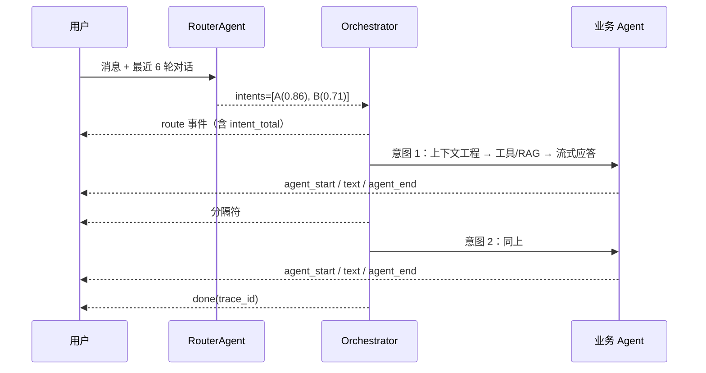

# 一条消息两个诉求：对话式 Agent 的多意图路由与提示词去具名化

> 面向正在做企业对话 Agent 的后端/平台工程师。以 AgentDock 的实现为例，讲清楚三件事：意图契约怎么设计、路由提示词怎么不写死业务、兜底与可观测怎么收口。
> 代码与配置细节见仓库 `backend/app/agents/router_agent.py`、`backend/app/agents/orchestrator.py`。

## 1. 单意图路由会在哪里断掉

最初的实现很直接：路由模型输出 `{agent_name, confidence, reason}`，调度层按名字找 Agent，跑一轮回答。单场景、单诉求时没问题，一旦进入真实业务就会碰到三处断点。

**第一处：复合诉求被丢掉一半。** "我要查订单 SO20240002，顺便申请退款"包含两个动作。单意图只能二选一，用户往往要再问一遍。

**第二处：追问没有落点。** "那什么时候到？"脱离上下文无法判断该续接订单还是物流。路由需要知道上一轮是谁承接的。

**第三处：规则写在提示词里。** 早期提示词写着"涉及订单号/物流优先 order_service""投诉优先 complaint_handler"。这三个代码 Agent 天然有先验，后台新建的 Agent 只有一行描述，永远抢不到意图——平台能力被提示词里的硬编码限制住了。

多意图路由要同时解决这三件事，而不只是把返回结构从对象改成数组。

## 2. 契约：从 `agent_name` 到 `intents[]`

路由输出改成按主次排序的意图数组：

```json
{
  "intents": [
    {"agent_name": "order_service", "confidence": 0.86, "reason": "用户提供了订单号并要求查询"},
    {"agent_name": "complaint_handler", "confidence": 0.71, "reason": "用户明确提出退款诉求"}
  ]
}
```

同时保留顶层 `agent_name` / `confidence` / `reason` 作为主意图的兼容字段，旧调用方无需改动。

解析层做归一化，原则是"**宁可降级，不可崩溃**"：

- 容忍 ```json 代码块与前后杂字，取第一个 JSON 对象；
- 未注册、重复、空的 `agent_name` 直接丢弃；
- 全部无效或解析失败，回落为兜底 Agent + 固定低置信度；
- 继续接受旧的单意图格式。

这样模型偶尔抽风不会把整轮对话打挂，只是退化成"只答一个意图"。

### 顺序不重排

意图数组保持模型给出的主次顺序，不按置信度重排。原因是"主次"本身是语义判断：用户先说的事通常更重要，而置信度只反映模型对分类的把握。把两者混为一谈会让回答顺序变得不可预测。

## 3. 提示词：把业务规则搬回数据

### 3.1 去具名化

提示词里删掉所有"某类问题优先某个 Agent"的条款，改成一条通用判据：

> 选择依据只看各 Agent 声明的适用范围、关键词、典型问法与用户消息的贴合度；不要凭名称猜测职责，也不要偏向某个特定 Agent。

再加一条约束，抑制模型改写名称：

> 逐字照抄候选清单中冒号前的名称，不得翻译或改写。

### 3.2 让每个 Agent 自带线索

候选清单不再是"一行名字 + 一行描述"，而是信息块：

```
- invoice_service：开票服务：受理开票申请、修改抬头
  关键词：发票、开票、抬头、税号
  典型问法：帮我开张发票 / 发票抬头写错了能改吗
```

数据层对应两个字段：

| 字段 | 语义 | 建议 |
|---|---|---|
| `routing_keywords` | 字面线索，客户口语说法 | 5–12 个 |
| `routing_examples` | 语义线索，典型问法 | 2–3 条 |

代码 Agent 用类属性声明，动态 Agent 在后台表单填写，两者同构。注入时只取前 12 个关键词、前 3 条问法，控制提示词体积；没填线索的 Agent 降级为一行描述，不报错、不阻塞。

这一步之后，新增 Agent 不需要改路由代码，也不需要改提示词，只要把"何时该选我"写清楚。

### 3.3 兜底名也要动态

原来兜底 Agent 的名字硬编码在提示词和常量里。一旦后台禁用了那个 Agent，模型仍被要求输出它，解析层当作未注册丢弃，最终报"Agent 未注册"。

现在提示词里用占位符，运行时按生效清单派生：优先候选（如知识问答 Agent），不可用则取第一个生效 Agent。清单为空才回退到旧契约名。

## 4. 调度：为什么串行而不是并行



并行看起来更快，但会带来三个问题：

1. **上下文互相污染**：两个 Agent 同时读写同一轮记忆，语义记忆的写入顺序不可控；
2. **前端渲染混乱**：两段流式文本交错到达，用户无法分辨哪句属于哪个诉求；
3. **工具副作用**：退款、改单这类写操作并发执行，失败回滚与提示都很难做。

所以选择串行分块下发：

- 主意图置信度低于阈值 → 整轮转人工；
- 只有次要意图低于阈值 → 丢弃该分支，主意图照常；
- 第二个及之后的意图前插入 `\n\n---\n\n` 分隔；
- 每个分支前后发 `agent_start` / `agent_end`，带 `intent_index` / `intent_total`；
- 记忆归档一轮只做一次，记在实际承接者名下，避免多份重复记忆。

`ROUTER_MAX_INTENTS` 控制单轮最多执行几个意图，设为 `1` 即退回单意图模式。这个开关在排查"多意图导致回答变慢"时很有用。

## 5. 兜底：固定置信度与阈值的冲突

这里有一个很容易踩的坑：路由判定"不贴合任何 Agent"时，提示词约定兜底意图的置信度是固定低值 `0.3`。而默认阈值是 `0.5`，于是兜底意图在进入 Agent 之前就被"低置信转人工"拦掉——用户问"你是谁"会直接转人工，一句回答都没有。

修法不是改阈值，而是给兜底意图一条独立通道：

- 路由结果带 `is_fallback: true`；
- `ROUTER_FALLBACK_ANSWER=true`（默认）时，兜底意图不受阈值影响，先由兜底 Agent 应答；
- 设为 `false` 则恢复"也转人工"的旧行为。

另一个相关通道是"意图指向的 Agent 已不可用"（后台禁用、已删除、模型臆造名称）。此时调度层回落一次到兜底 Agent，每轮最多一次，避免多意图重复灌同一段兜底回答；兜底也不可用时，才返回"Agent 未注册"。

两条通道分开处理，是因为它们语义不同：一个"没有合适的 Agent"，一个"选中的 Agent 不在了"。

## 6. 可观测：让"凭什么判给它"可复查

路由是最容易被质疑的环节："这句话为什么判给订单 Agent？"只存一个 `reason` 字符串不够。

每轮链路里，路由 span 会为每个意图记录：

| 字段 | 含义 |
|---|---|
| `intent_index` / `confidence` / `reason` | 模型给出的顺序、置信度、理由 |
| `is_fallback` | 是否兜底意图 |
| `matched_keywords` | 原句中命中的路由关键词 |
| `clue_basis` | `keyword_hit` / `keyword_miss`（配了关键词但没出现）/ `no_keywords`（没配线索） |

`matched_keywords` 是**本地子串匹配**的结果，只作参考，不是模型的真实判据。但它能快速区分三种情况：

- 命中关键词：线索与用户说法对上了；
- 配了关键词但没命中：说明靠语义判的，应补充更贴近客户表达的线索；
- 没配关键词：该 Agent 在提示词里只有一行描述，本就吃亏。

运营台把这三个状态直接展示在链路详情里，减少"猜模型"的成本。

## 7. 失败模式清单

| 症状 | 根因 | 处置 |
|---|---|---|
| 只答一个诉求 | 模型没拆意图（`intents=1`） | 调路由提示词或换更强的路由模型 |
| 拆了但只执行一个 | `ROUTER_MAX_INTENTS=1`，或次要意图低于阈值被丢弃 | 调整配置；看链路里的置信度 |
| 整轮转人工，没有回答 | 主意图低于阈值；或兜底通道被关 | 检查 `ROUTER_CONFIDENCE_THRESHOLD` 与 `ROUTER_FALLBACK_ANSWER` |
| "你是谁"直接转人工 | 兜底意图 0.3 被阈值拦截（旧版本缺陷） | 升级到带兜底通道的版本 |
| 报"Agent 未注册" | 模型输出了不存在的名称，且兜底也不可用 | 检查候选清单与 Agent 启用状态 |
| 新 Agent 永远不被选中 | 未配置 `routing_keywords` / `routing_examples`，或关键词超出注入上限 | 补线索，控制在 12 个关键词、3 条问法内 |
| 回答顺序与预期不符 | 意图顺序由模型给出，未按置信度重排 | 用 `routing_examples` 明确主次，或在提示词中强调"按用户表述顺序" |

## 8. 配置与验证

| 变量 | 默认 | 作用 |
|---|---|---|
| `ROUTER_MODEL` | `deepseek-flash` | 路由专用轻量模型，必须与供应商匹配 |
| `ROUTER_CONFIDENCE_THRESHOLD` | `0.5` | 主意图低于该值整轮转人工 |
| `ROUTER_MAX_INTENTS` | `2` | 单轮最多执行意图数，`1` 关闭多意图 |
| `ROUTER_FALLBACK_ANSWER` | `true` | 兜底意图是否绕过阈值先应答 |

验证建议覆盖四类用例：

1. 新/旧两种路由输出格式都能解析；
2. 非法、重复、未注册的意图名被丢弃，不抛异常；
3. 多意图按顺序串行、有分隔符、事件带 `intent_index`；
4. 主意图低置信转人工、次要意图低置信被丢弃、兜底意图不受阈值影响。

这些用例在仓库的 `tests/test_router.py` 与 `tests/test_orchestrator_multi_intent.py` 中都有对应实现。

## 9. 小结

多意图路由不是"让模型多返回几个名字"，而是四件事一起收口：

1. **契约可演进**：新结构兼容旧格式，解析失败有降级路径；
2. **规则数据化**：业务先验从提示词搬回 Agent 自身字段，内核不写业务名；
3. **调度可解释**：串行、阈值、分隔、兜底各有一条明确规则，出问题能定位到具体分支；
4. **证据可复查**：链路里留下意图顺序、置信度与线索命中情况，运营能自己判断该补什么。

把这四件事做完，路由才从"模型碰运气"变成"平台可运营的能力"。
